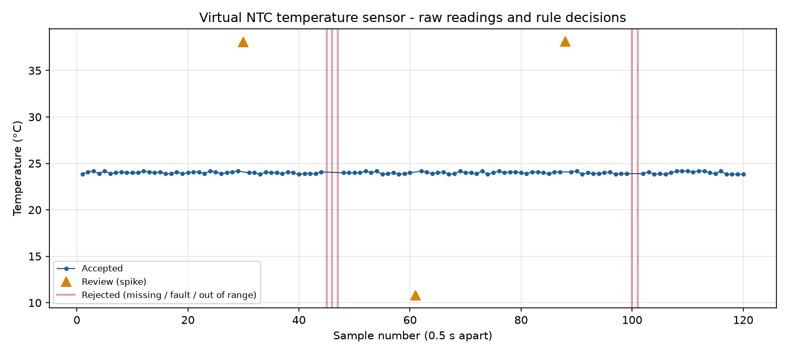

# First Readings: Virtual Sensor Reliability Lab - Analysis Report

*Generated by `analyze.py` from `data/raw_readings.csv`. Rerun the script after collecting new data.*

## Sensor and Measurement
NTC thermistor temperature module (10 kΩ NTC, β = 3950, in series with a 10 kΩ resistor), read on Arduino Uno pin A0.
The board reports the raw 10-bit ADC count (0-1023) and the temperature in **degrees Celsius (°C)** converted with the β equation.
The module's supported range is -40 to 125 °C.

## Simulation Platform
Velxio (browser Arduino simulator). Project file: `arduino-temp-sensor-lab.vlx`. Sketch: `sketch/temperature_sensor_lab.ino`.

## Collection Method
- **Samples:** 120 readings, one every 0.5 s over about 60 s of simulation time, printed as CSV on the Serial Monitor and saved unedited in `data/raw_readings.csv`.
- **Temperature changes:** the sensor's temperature was changed by hand during the run with the component's temperature control.
- **ADC noise:** the simulator's ADC is ideal, so the sketch adds ±2 counts of noise, as a real 10-bit ADC typically shows.
- **Injected conditions:** the sketch deliberately adds three one-sample electrical spikes (samples 30, 61, 88), a three-sample dropout where no reading arrives (45-47), and a two-sample short circuit with the ADC pinned at 1023 (100-101).
- **Labeling:** every injected row is marked in the `sim_note` column. The rejection rule never reads that column, so it is used only to check how well the rule performed.

## Observed Range
| Statistic | Accepted readings (112) | All numeric raw values (117) |
|---|---|---|
| Minimum (°C) | 23.82 | -273.15 |
| Maximum (°C) | 24.17 | 38.15 |
| Mean (°C) | 24.00 | 19.04 |
| Median / typical (°C) | 23.99 | 23.99 |
| Range (°C) | 0.35 | 311.30 |
| Standard deviation (°C) | 0.11 | 38.76 |

The right-hand column shows how much a few bad readings distort the summary. The short-circuit rows convert to -273.15 °C (absolute zero), which is physically impossible.

## Normal Variation
- **Sample-to-sample change:** among accepted readings, the typical (median) change was **0.09 °C**. 95% of changes were ≤ **0.27 °C**, and the largest accepted change was 0.35 °C.
- **Noise level:** at room temperature one ADC count is about 0.1 °C, so the ±2-count noise appears as roughly ±0.2 °C of jitter.
- **Overall trend:** the larger, slower movement in the trend comes from the temperature changes made during the run.

## Suspicious Readings
| Sample | Raw ADC | Temp (°C) | Board status | Decision | Reason | Injected? |
|---|---|---|---|---|---|---|
| 30 | 373 | 38.05 | OK | REVIEW | R4 spike +13.88 C, not confirmed by next reading | injected_spike |
| 45 | - | - | NO_DATA | REJECT | R1 missing value | injected_dropout |
| 46 | - | - | NO_DATA | REJECT | R1 missing value | injected_dropout |
| 47 | - | - | NO_DATA | REJECT | R1 missing value | injected_dropout |
| 61 | 675 | 10.80 | OK | REVIEW | R4 spike -13.19 C, not confirmed by next reading | injected_spike |
| 88 | 372 | 38.15 | OK | REVIEW | R4 spike +14.07 C, not confirmed by next reading | injected_spike |
| 100 | 1023 | -273.15 | SENSOR_FAULT | REJECT | R2 ADC at rail (1023) - open/shorted sensor | injected_short |
| 101 | 1023 | -273.15 | SENSOR_FAULT | REJECT | R2 ADC at rail (1023) - open/shorted sensor | injected_short |

Why each pattern deserves investigation:
- **Missing values (NO_DATA).** No measurement arrived, so any value filled in would be invented. Three in a row point to a connection problem, not random noise.
- **ADC pinned at 1023.** The divider is at a rail, which means a shorted thermistor or wiring fault. The β equation turns this into -273.15 °C, an impossible temperature. Two in a row is a repeated failure, not noise.
- **Single-sample spikes of about 10-15 °C.** These are far larger than the observed sample-to-sample variation, and the next reading returns to the previous level. A real air or liquid temperature cannot jump that far and back within 1 second.
- **Large jumps that persist.** These are not treated as errors. If the next reading stays at the new level, the change is most likely real (in this run, the temperature control being moved).

**Finding about the original sketch:** it applied the TMP36 formula (voltage − 0.5) × 100 to an NTC divider. At the project's saved setting of 72 °C, the ADC reads about 145 counts, which that formula reports as about 20.7 °C with status "OK". An overheating condition would look normal. The original code also labeled any reading below 0 °C as "MISSING", even though cold readings are valid data. Both issues were corrected before collecting this dataset.

## Proposed Rejection / Filtering Rule
Apply these checks in order. Rejected readings stay in the raw file; they are only excluded from the trusted dataset (`results/classified_readings.csv`).
1. **R1 Missing.** No temperature value → **REJECT**.
2. **R2 Sensor fault.** Raw ADC ≤ 5 or ≥ 1018 (open or shorted sensor) → **REJECT**.
3. **R3 Out of range.** Temperature not finite or outside -40 to 125 °C → **REJECT**.
4. **R4 Unconfirmed spike.** The reading differs by more than **5 °C** from the last accepted reading, and the next reading does **not** stay within 5 °C of it → **REVIEW** (excluded from statistics but kept for a person to check). If the next reading confirms the new level, the jump is **ACCEPTED** as a real step change.

The 5 °C limit is more than 20 times the typical sample-to-sample change measured above. R2 and R3 come from the sensor's documented behavior, not from this dataset.

**Result on this dataset:** 112 accepted, 5 rejected, 3 sent to review.

## Cost of the Rule
- **Real fast events can be lost.** R4 needs the next reading to confirm a jump, so a genuine event lasting a single sample (0.5 s) is excluded. Examples are a burst of hot air or a contact transient. If the process can really change by more than 5 °C in one sample, the rule hides it.
- **Real changes are confirmed late.** A real step change is only confirmed once the following reading arrives, adding at least 0.5 s of delay.
- **Valid extremes can be removed.** R3 rejects anything outside -40 to 125 °C. A real temperature beyond the sensor's range, which is exactly when an alarm matters, would be discarded instead of reported as "too hot". A better system would raise an alarm for these readings rather than silently drop them.
- **Gaps are hidden.** Rejected rows are removed from the statistics, so the summary looks more stable than the stream really was. That is why rejected and review counts are always reported next to the statistics.
- **A slow failure passes.** A drifting or slowly failing sensor that changes less than 5 °C per sample passes every check.

In this run every excluded reading was an injected condition, so the rule did not remove any real data here. That is a property of this dataset, not a guarantee.

